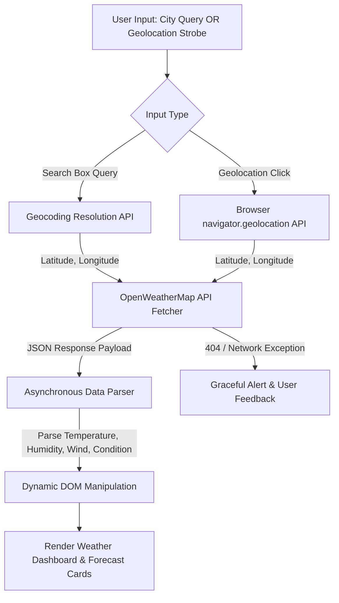

<div align="center">
  # 🌤️ Dynamic Weather Forecasting Web Application

  **Vinayak Sharma**  
  *ByteBastion Engineering Laboratory*

  Dvision: Bug.exe

  <p align="center">
    
    
    
    
    
  </p>

  <p align="center">
    <a href="https://github.com/TechBastards/Weather-Forecasting-Website">
      
    </a>
  </p>
</div>

A responsive, lightweight weather forecasting web application engineered with vanilla **HTML5, modern CSS3, and ES6+ JavaScript**. It consumes the **OpenWeatherMap REST API** to deliver real-time meteorological conditions, multi-day forecasts, and automated browser geolocation detection.

---

## 📌 Project Overview

Many entry-level weather projects suffer from static mock data, hardcoded coordinates, or insecure credential storage.

This project delivers a complete, secure client-side weather interface:
* **Global Location Search:** Queries real-time meteorological observations for any city, state, or country.
* **HTML5 Geolocation Integration:** Resolves device coordinates with user permission to automatically fetch hyper-local weather.
* **Multi-Day Historical Forecast:** Renders temperature and atmospheric condition trends across recent days.
* **Resilient Error Handling:** Validates user queries gracefully against geographic boundaries, presenting clean modal alerts if locations are invalid or network requests time out.
* **Security Best Practices:** Sanitized codebase with zero committed API credentials; configurable via `.env.example`.

---

## 🗺️ System Workflow Architecture



---

## 📁 Repository Structure

```
Weather-Forecasting-Website/
├── index.html        # Semantic HTML5 document structure
├── style.css         # Modern responsive CSS layout, typography & transitions
├── script.js         # Asynchronous fetch logic, DOM controller & geolocation
├── .env.example      # Template demonstrating OpenWeatherMap API key configuration
├── demo.mp4          # Recorded interface demo video
└── README.md         # Documentation and developer instructions
```

---

## 🛠️ Getting Started & Setup

### 1. Prerequisites
* Any modern web browser (Google Chrome, Firefox, Safari, Edge)
* A free [OpenWeatherMap API Key](https://home.openweathermap.org/users/sign_up)

### 2. Clone the Repository
```bash
git clone https://github.com/TechBastards/Weather-Forecasting-Website.git
cd Weather-Forecasting-Website
```

### 3. Configure Your API Key
1. Copy `.env.example` as a reference or open `script.js`.
2. Locate the `apiKey` variable in `script.js` (around Line 6):
   ```javascript
   const apiKey = "YOUR_ACTUAL_OPENWEATHERMAP_API_KEY";
   ```
3. Paste your OpenWeatherMap key into the quotes.

### 4. Run the Website
Simply open `index.html` in your browser:
* **Double-click** `index.html` directly in your file explorer, OR
* Use a local dev server (e.g., VS Code *Live Server* or Python):
  ```bash
  python -m http.server 8080
  ```
  Then visit `http://localhost:8080`.

---

## 🎯 Usage Instructions

1. **City Search:**
   - Type a target location (e.g., `Tokyo`, `San Francisco`, `London`) into the search bar.
   - Click **Search** or press Enter.
   - Instant metrics for temperature, humidity, wind velocity, and weather descriptions will render dynamically.
2. **Device Geolocation:**
   - Click the **"Use Current Location"** button.
   - Click **"Allow"** when prompted for browser location permission.
   - The app resolves device GPS coordinates and renders local weather immediately.

---

## 👨‍💻 Author

**Vinayak Sharma**  
*Lead Developer & Hardware/Software Enthusiast*  

---

## 📄 License
This project is open-source and available under the [MIT License](LICENSE).
